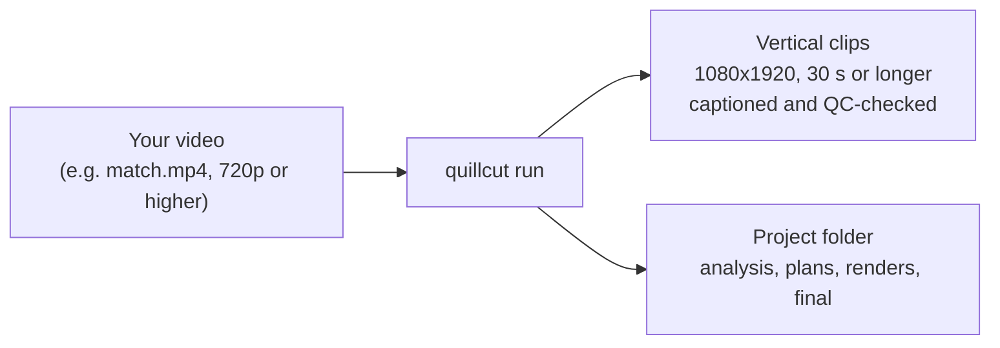
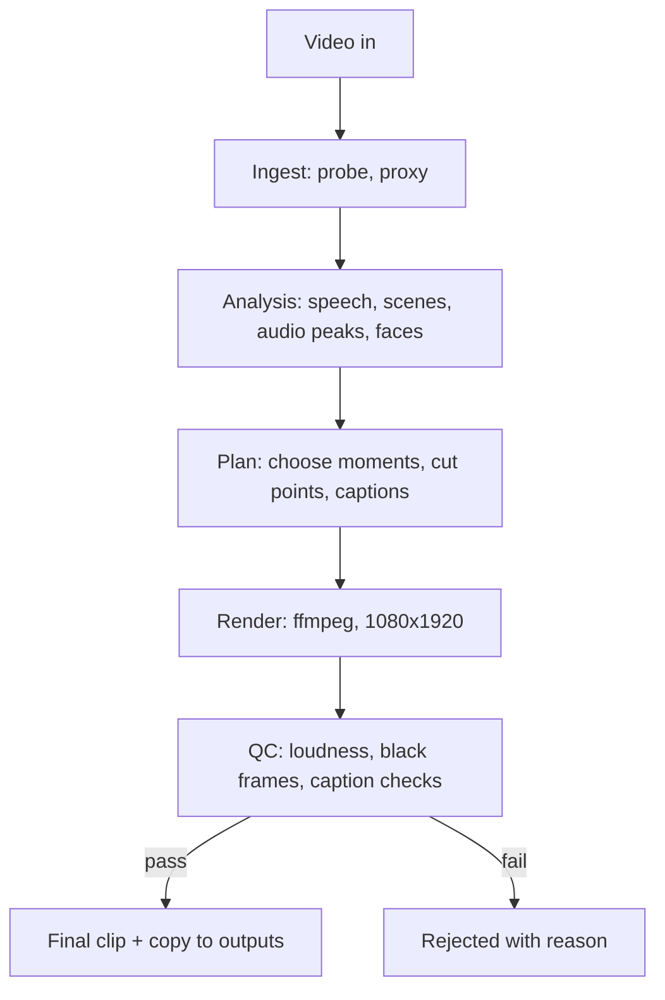
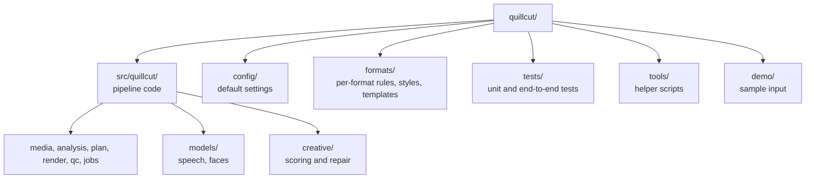

# Quillcut

Quillcut turns a long video into short vertical clips. Give it one video, and it finds the strongest
moments, cuts them, adds captions, normalises the audio, and checks each clip before it's saved.

Everything runs on your own machine. Nothing is uploaded.

## Input and output



```bash
quillcut run match.mp4 --format gaming --rights own_footage
```

- **Input:** one video file, at least 480 px on the short side.
- **Output:** finished clips in `data/outputs/<date>/gaming/`, and the full project in
  `formats/gaming/projects/<project>/`.
- **Rights:** clips are only written when you say where the footage came from, with `--rights`
  (`own_footage`, `client_owned`, `client_licensed` or `cc_verified`).

## How it works



The optional `creative` command adds a second pass that scores each reel with a local model and can
repair it. It needs [Ollama](https://ollama.com) running; the rest of the pipeline does not.

## Install

You need Python 3.11, [ffmpeg](https://ffmpeg.org) on your PATH, and optionally an NVIDIA GPU.

```bash
git clone https://github.com/VARSHITH707/quillcut.git
cd quillcut
python -m venv .venv
```

Activate the environment:

```bash
# Windows (PowerShell)
.venv\Scripts\Activate.ps1
# macOS / Linux
source .venv/bin/activate
```

Install PyTorch first. Use the CUDA build if you have an NVIDIA GPU, or the CPU build otherwise:

```bash
# NVIDIA GPU (CUDA 12.6)
pip install torch==2.11.0 torchvision==0.26.0 --index-url https://download.pytorch.org/whl/cu126
# CPU only
pip install torch==2.11.0 torchvision==0.26.0 --index-url https://download.pytorch.org/whl/cpu
```

Then install Quillcut:

```bash
pip install -e ".[dev]"
```

Check that everything is in place:

```bash
quillcut doctor
```

## Try the demo

The demo uses a generated 45-second sample in `demo/sample.mp4`:

```bash
quillcut run demo/sample.mp4 --format gaming --rights own_footage --fast
```

The sample has no real moments in it, so expect one clip to pass and the second candidate to be
rejected. That's the intended behaviour.

## Other commands

| Command | What it does |
|---|---|
| `quillcut run VIDEO --format gaming --rights ...` | Automatic clips from one video |
| `quillcut script NAME --a VIDEO [--b VIDEO]` | One clip from a named script template |
| `quillcut reels BOOK.yaml` | Render hand-directed reels from a YAML book |
| `quillcut creative BOOK.yaml` | Score, repair and re-render reels (needs Ollama) |
| `quillcut explain PROJECT CLIP_ID` | Show why a clip looks the way it does |
| `quillcut batch FOLDER` | Run every video in a folder |
| `quillcut doctor` | Check ffmpeg, GPU, fonts and models |

Add `--fast` to any render command for a quicker, lower-quality encode while testing.

## Project layout



Your own data (outputs, caches, downloaded models) goes in `data/`, which is git-ignored. To keep it
on another drive, set `QUILLCUT_HOME` to a folder path.

## Tests

```bash
pytest tests -q                 # everything (about 2 to 3 minutes, renders video)
pytest tests -q -m "not slow"   # quick run
```

## Security

- Static analysis with [bandit](https://bandit.readthedocs.io): run `bandit -r src tools`.
  The remaining findings are intentional and marked in the code.
- ffmpeg and ffprobe are always called with argument lists, never through a shell.

## License

No licence has been chosen yet. Until one is added, all rights are reserved by the author.
