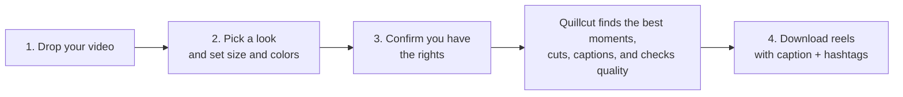
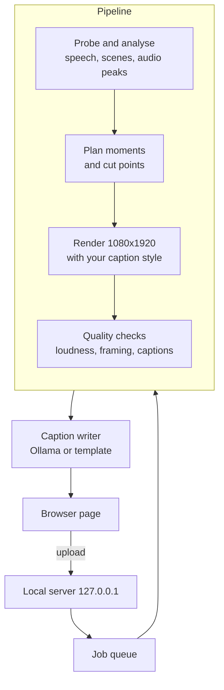

<p align="center">
  
</p>

# Quillcut Studio

Drop one long video into the browser, pick a caption style, and get vertical reels with captions and
hashtags ready to download. Everything runs on your own computer. Nothing is uploaded anywhere.

## The app in one picture



**Input:** one video file (MP4, MOV, MKV or WEBM, at least 20 seconds, 720p or higher works best).
**Output:** 1080x1920 reels you can preview and download, each with a written caption and hashtags,
plus a zip of everything.

## Quick start

**Works on Windows 10/11** (tested). macOS and Linux are not supported yet: the GPU lock and the
caption fonts are Windows-specific.

You need Python 3.11, [ffmpeg](https://ffmpeg.org) on your PATH, and optionally an NVIDIA GPU and
[Ollama](https://ollama.com) for AI-written captions.

### Easiest: double-click `launch.bat`

```powershell
git clone https://github.com/VARSHITH707/quillcut.git
cd quillcut
.\launch.bat
```

The first run sets everything up (a few GB, several minutes) and opens the app. After that it
starts in seconds. Keep the window open while you use the app, and close it to stop.

### Manual setup

```powershell
python -m venv .venv
.venv\Scripts\Activate.ps1
```

Install PyTorch (pick one), then Quillcut:

```powershell
# NVIDIA GPU (CUDA 12.6)
pip install torch==2.11.0 torchvision==0.26.0 --index-url https://download.pytorch.org/whl/cu126
# or CPU only
pip install torch==2.11.0 torchvision==0.26.0 --index-url https://download.pytorch.org/whl/cpu

pip install -e ".[dev]"
```

Start the app:

```powershell
quillcut web
```

Your browser opens at <http://127.0.0.1:8765>. Press `Ctrl+C` in the terminal to stop it.

### Optional: AI-written captions

Captions and hashtags are written by a local model through Ollama. Without it, the app still works
and uses a simple template built from the reel's transcript, and it labels each caption so you know
which one you got.

```bash
ollama pull qwen2.5:7b-instruct-q4_K_M
```

## How it works



- The server only listens on `127.0.0.1` and refuses requests from other sites.
- Reels that fail a quality check are not offered for download, and the page says why.
- Your videos and reels live in the `data/` folder next to the code. Set `QUILLCUT_HOME` to move it.

## Command line

The same engine is available without the browser:

```bash
quillcut run match.mp4 --format gaming --rights own_footage
```

| Command | What it does |
|---|---|
| `quillcut web` | Open the drag-and-drop app |
| `quillcut run VIDEO --format gaming --rights ...` | Automatic reels from one video |
| `quillcut script NAME --a VIDEO [--b VIDEO]` | One reel from a named script template |
| `quillcut reels BOOK.yaml` | Render hand-directed reels from a YAML book |
| `quillcut creative BOOK.yaml` | Score, repair and re-render reels (needs Ollama) |
| `quillcut explain PROJECT CLIP_ID` | Show why a reel looks the way it does |
| `quillcut doctor` | Check ffmpeg, GPU, fonts and models |

Try it with the generated sample in `demo/sample.mp4`:

```bash
quillcut run demo/sample.mp4 --format gaming --rights own_footage --fast
```

The sample is a test pattern with no real moments, so expect one reel to pass and the second
candidate to be rejected.

## Project layout

```text
quillcut/
├── src/quillcut/
│   ├── web/          # local web app: server.py, copywriter.py, static/ (HTML, CSS, JS)
│   ├── jobs.py       # pipeline orchestration
│   ├── render.py     # ffmpeg rendering
│   ├── qc.py         # quality checks
│   ├── models/       # speech and face models
│   └── creative/     # optional scoring and repair
├── formats/          # per-format rules, caption styles, script templates
├── config/           # default settings
├── tests/            # unit and end-to-end tests
├── tools/            # helper scripts
└── demo/             # sample input
```

## Rights

Reels are only produced when you say where the footage came from. In the app this is the
confirmation box; on the command line it is `--rights` (`own_footage`, `client_owned`,
`client_licensed` or `cc_verified`). Make sure you have permission before you post anything.

## Tests and security

```bash
pytest tests -q                 # about 3 minutes, renders real video
pytest tests/unit -q            # fast checks only
bandit -r src tools             # static security scan
```

## License

[MIT](LICENSE) © 2026 VARSHITH707
