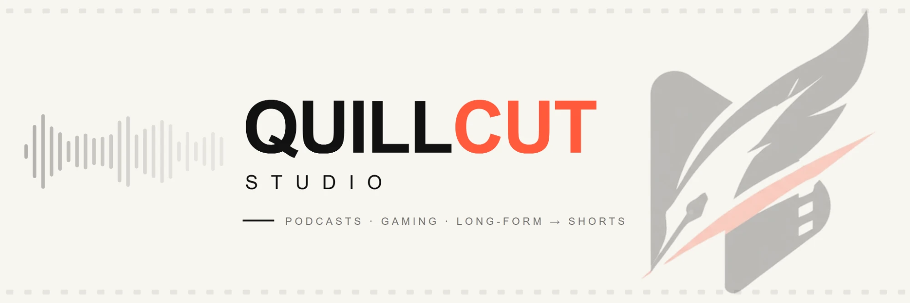
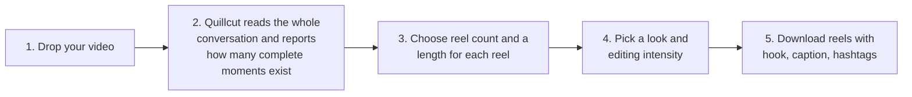
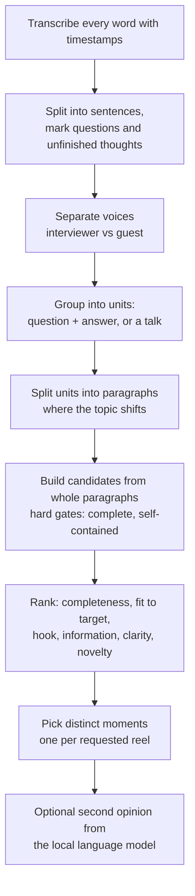

<p align="center">
  
</p>

# Quillcut Studio

Drop in one long video of people talking. Quillcut reads the **whole conversation first**, picks the
moments that are complete (a question and its full answer, a finished story, a finished explanation),
edits each one properly, and gives you reels with a caption and hashtags, ready to download.

Everything runs on your own computer. Nothing is uploaded anywhere.

## What it does differently

| Problem with typical clippers | What Quillcut does |
|---|---|
| Cuts at a timestamp, mid-answer | Never starts or ends mid-sentence. Reels end where the thought ends. |
| Fixed length for every clip | Each reel has its own target (30, 35, 60, 90… or any value). The target is a goal: a reel runs longer when the answer needs it, and tells you so. |
| Ignores who is speaking | Separates the interviewer from the guest and keeps the question with its answer. |
| Subtitles and nothing else | Speaker-following framing, punch-ins, an animated title, key-term emphasis, key-phrase callouts, a lower-third and loudness-matched audio. |
| Makes filler to hit the count | If the video only supports 3 distinct complete moments and you ask for 5, you get 3 and an explanation. |



## Quick start (Windows 10/11)

You need Python 3.11 and [ffmpeg](https://ffmpeg.org) on your PATH. An NVIDIA GPU and
[Ollama](https://ollama.com) are optional but recommended.

```powershell
git clone https://github.com/VARSHITH707/quillcut.git
cd quillcut
.\launch.bat
```

The first run sets everything up (a few GB, several minutes) and opens the app at
<http://127.0.0.1:8765>. After that it starts in seconds. Keep the window open while you use it.

For AI-written captions and hashtags (optional, free, runs locally):

```powershell
ollama pull qwen2.5:7b-instruct-q4_K_M
```

<details>
<summary>Manual setup instead of launch.bat</summary>

```powershell
python -m venv .venv
.venv\Scripts\Activate.ps1
# NVIDIA GPU (CUDA 12.6)
pip install torch==2.11.0 torchvision==0.26.0 --index-url https://download.pytorch.org/whl/cu126
# or CPU only
pip install torch==2.11.0 torchvision==0.26.0 --index-url https://download.pytorch.org/whl/cpu
pip install -e ".[dev]"
quillcut web
```
</details>

## Using the app

1. **Upload** your video (MP4, MOV, MKV, WEBM; at least 20 seconds; 720p or higher works best).
   Quillcut immediately reads the whole thing and tells you how many distinct, complete moments it
   found, with the opening line of each.
2. **Reels:** choose how many (1, 2, 3, 5, 10 or any number up to 20). One duration control appears per
   reel, with presets of 30, 35, 45, 60, 75 and 90 seconds plus a custom value.
3. **Look:** caption style, content style (interview, podcast, educational, storytelling, motivational,
   debate, business), editing intensity, and aspect ratio.
4. **Make it yours:** caption size and position, colours, brand colour, optional logo, closing line,
   optional quiet background music.
5. **Confirm** you have the rights, and make the reels.

Each finished reel shows the **target and the actual duration**, whether it was **extended to finish the
thought** (and by how much), the **hook line** it opens on, the **source timestamps**, the **checks it
passed**, an editable **caption and hashtags**, and download buttons. Two buttons let you try again:
*New length* re-cuts the same moment to a different target, and *Try another moment* picks the next-best one.

### Duration rules

* The selected duration is a **target**. If the speaker is still finishing the point at the target, the
  reel is extended to the natural end, up to a hard maximum (about 1.75× the target, at least +30 s).
* A reel is never padded. If the thought finishes early, it ends early and says so.
* **Strict mode** never runs past the target. If a complete answer does not fit, that reel is skipped and
  you are told how long the answer needs, instead of cutting it off.
* A 90-second answer that is longer than the maximum ends at a paragraph boundary and is marked as a part.

## Inputs from anywhere

| Input | Upload a file | Or paste a link |
|---|---|---|
| **Video** (required) | MP4, MOV, MKV, WEBM, M4V, AVI | YouTube, TikTok, Instagram, Vimeo, X and other video sites; a Google Drive file; a Google Drive **folder** (you pick which video); a direct link to a video file |
| **Rules** (optional) | .txt, .md, **.docx (Word)**, **.pdf**, .html | A **Google Doc**; a Word or PDF file on Google Drive; any web page |
| **Photos** | PNG, JPG, WEBP (as the logo or as mixed footage) | Photos inside a shared Drive folder are collected and added to mixed footage |
| **Music** (optional) | MP3, WAV, M4A, AAC, FLAC, OGG | |
| **Mixed footage** (optional) | Any video (no minimum length) or photo, up to 12 files | A Drive folder, a video site, or a direct file link |

Links must work without signing in: on Google Drive and Docs that means sharing set to *Anyone with the link*.
When a link can't be used, the app says why in plain words: the file is private, Google's download quota for a
popular file is exhausted ("try again later or download it yourself"), the link is a web page rather than a
file, or the video is private. Links to private or local network addresses are refused.

Not yet: private Google Drive files would need your Google account connected, which the app does not do.

## Two inputs: a video (required) and rules (optional)

Quillcut never runs without a **video**. Rules are optional: with no rules it behaves exactly as described
above, and rules on their own cannot make reels. In the app, type rules (or load a `.txt` file) under the
video. A live preview shows what Quillcut understood *before* anything runs.

Write one rule per line, in plain words. These are **enforced**:

| You write | What happens |
|---|---|
| `Only clips about pricing and churn` | Only moments that mention those words are considered |
| `Must mention onboarding` | Every moment must mention it |
| `Never mention Acme Corp` / `Avoid competitors` | Moments that say it are never chosen |
| `No profanity` / `Keep it clean` | Moments with swearing are never chosen |
| `Every clip must include a statistic` | The reel must contain a spoken number |
| `No longer than 45 seconds` / `At least 20 seconds` / `35 second reels` | Length limit, minimum, or target |
| `High energy` / `Minimal edit` / `Square video` / `16:9` | Editing intensity and shape |
| `No music` / `Add subtle music` | Background music |
| `Skip the interviewer's question` / `Keep the question` | Whether the question is in the video |
| `Start with a question` / `No cold open` | How the hook is chosen |
| `End with "Follow for more"` | Closing line |
| `Cut on the beat` / `✕ off-beat cuts` | Cuts land on the music's beats |
| `Elegant, dark, a little hazy` / `VHS textures` | Hazy or VHS colour grade |
| `Catalog typography, not meme font` | Serif *Catalog* caption style |

How rules are treated:

* **Rules win over the page's settings,** and every change is listed (for example *High energy* overrides a
  *Clean* selection).
* A moment that breaks a rule is never chosen. If the rules rule everything out, you get no reel and a reason,
  never a reel that breaks your rules.
* The rules are **re-checked against the finished reel's actual words** and shown on each reel card.
* A line Quillcut cannot check mechanically (for example *keep the tone friendly*) is listed as **not enforced**.
  The local model gives a non-binding opinion per reel, clearly labelled as an opinion.

## How the clipping decision is made



A candidate must pass these gates before it is ever ranked: it starts on a sentence start, ends on a
finished sentence, is not continued by the next sentence, does not open on a reference like "so" or
"that" without its question, and (for a question and answer) reaches the end of the answer unless the
answer exceeds the maximum.

## The edit

* **Hook (first 3 seconds):** a verbatim line from the conversation, shown in one or two frames of at most
  five words. It is the question, the opening line, or a stronger line from later in the same answer played
  first as a cold open. Each hook is labelled with its archetype (loss avoidance, insider information, status
  and optimisation, contrarian) when the speaker's own words fit one. Nothing is rewritten or invented, and a
  shortened line is marked with "…".
* **Framing:** vertical crops follow the active speaker (face detection, with mouth movement choosing
  between several faces). Framing changes happen on sentence boundaries.
* **Pacing:** silences longer than 0.40 s are tightened to 0.18 s, and filler sounds ("um", "uh") are removed.
  Real words are never removed, including "like" and "you know".
* **Motion graphics:** animated title with an accent bar, a "Question" lower-third, key terms in the
  accent colour, key-phrase callouts quoted from the speaker, and an optional progress bar and closing line.
* **Sound:** loudness matched, peaks limited, optional noise reduction, optional music that ducks under speech.
* **Intensity** (a framing change falls between two words, so audio runs straight through every cut):
  *clean* every 3-4 s at 1.0x/1.05x; *dynamic* every 2-2.5 s at 1.0x/1.10x/1.14x with a callout;
  *high energy* every 1.2-1.8 s at 1.0x/1.12x/1.18x with two callouts and a progress bar.
* **Captions:** 3-5 words per card, locked to the centre third of the frame (35%-65% of the height; 60% by
  default), active word highlighted, bold type with a dark outline. The *Catalog* style swaps this for a
  Bodoni title and Georgia captions in cream and champagne, with fades instead of pops.
* **Cut on the beat:** with a music track, Quillcut finds its tempo and beats, slides the track against the reel
  so as many beats as possible fall between two words, and cuts there. A beat that lands inside a word is
  skipped, never forced, and the music starts at the matching point of the track. Every shot is a whole number
  of frames.
* **Look:** *Hazy* (lifted blacks, muted colour, soft glow, light grain, vignette), *Film* or *VHS*. The grade
  covers footage and cutaways; captions are drawn on top so they stay crisp.
* **Mixed footage:** your clips and photos (old ads, cartoons, game footage, textures) replace the picture for
  one shot at a time while the speaker keeps talking. Never inside the hook seconds, never on the strongest
  line, never two in a row, never the last shot, at most 20% (*light*) or 33% (*medium*) of the reel. Photos
  get a slow push-in; landscape clips sit over a blurred fill.
* **Post copy:** a re-hook under 10 words, 3-4 bullets taken from the speaker's own sentences, and a call to
  action by clip type (educational: "Save this guide for later.", opinion or debate: "Comment your thoughts
  below.", business: "Send this to a teammate."), plus hashtags.

Every reel is **audited after rendering**: the speech is transcribed again and compared with the plan, the hook
must be on screen in the first second, captions must be 5 words or fewer and inside the centre third, and every
overlay must sit inside the safe area. A reel that fails is flagged "needs a look" instead of silently delivered.

## Command line

```powershell
quillcut clip interview.mp4 --targets 35,60,90 --rights own_footage --intensity dynamic
quillcut web                                  # the app
quillcut run match.mp4 --format gaming        # the original loudness-peak clipper
quillcut doctor                               # check ffmpeg, GPU, fonts and models
```

| `clip` option | Meaning |
|---|---|
| `--targets 35,60,90` | One target (seconds) per reel |
| `--rules "only about pricing; no profanity"` | Optional rules in plain words (a video is still required) |
| `--rules-file rules.txt` | Optional rules, one per line |
| `--strict` | Never exceed a target; report the conflict instead |
| `--include-question auto\|yes\|no` | Keep the interviewer's question in the reel |
| `--intensity clean\|dynamic\|high_energy` | How much editing |
| `--aspect 9:16\|1:1\|16:9` | Output shape |
| `--content-style interview\|podcast\|…` | Ranking bias for the kind of content |
| `--no-llm`, `--no-verify` | Skip the model second opinion / the re-listen check |

## Honest limits

* **Windows only** today (the GPU lock and caption fonts are Windows-specific).
* **Speaker separation** is an estimate from voice pitch and tone. It works well for two clearly
  different voices; very similar voices may be treated as one. It does not name people.
* **Face-following framing** is tested on synthetic detections, not on a library of real interview
  footage. It falls back to a centred crop when no face is found.
* **The language model is advisory.** A small local model is a noisy judge, so it can only veto a moment
  when a separate deterministic check also says the speaker is still on the same point.
* **Music** needs a track: upload your own in the app, or run `python tools/make_music.py` to generate
  royalty-free beds. Beat tracking is tuned for music with a clear kick; very loose or beatless tracks give
  fewer beat cuts. Clearing the rights to a track is up to you.
* **Mixed footage is placed, not chosen by meaning:** cutaways go where the rules above allow, taking the files
  in turn. Pick footage that fits the episode.
* **Grain is capped** at 12 Mbps in the final file; platforms re-encode to far less anyway.
* The video must contain **speech**. Gameplay without commentary has no conversation to clip.

## Project layout

```text
quillcut/
├── src/quillcut/
│   ├── conversation.py      # sentences, units, candidates, ranking, selection (pure logic)
│   ├── speakers.py          # voice separation
│   ├── reelplan.py          # moment -> edit plan (hook, cuts, framing, graphics)
│   ├── reframe.py           # follow the active speaker
│   ├── conversation_job.py  # whole pipeline + post-render verification
│   ├── render.py, captions.py, qc.py   # rendering, motion graphics, quality checks
│   └── web/                 # local app: server, job types, static page
├── formats/  config/  tests/  tools/  demo/
```

## Tests and security

```powershell
pytest tests/unit -q          # fast: engine, planner, server (about 30 s)
pytest tests -q               # everything, including real-speech acceptance tests (several minutes)
bandit -r src tools           # static security scan
```

The acceptance tests synthesize a two-voice interview with Windows text-to-speech, run the full
pipeline, and check the rendered files: complete answers, extended durations, voice separation, and
honest shortfalls.

## License

[MIT](LICENSE) © 2026 VARSHITH707

